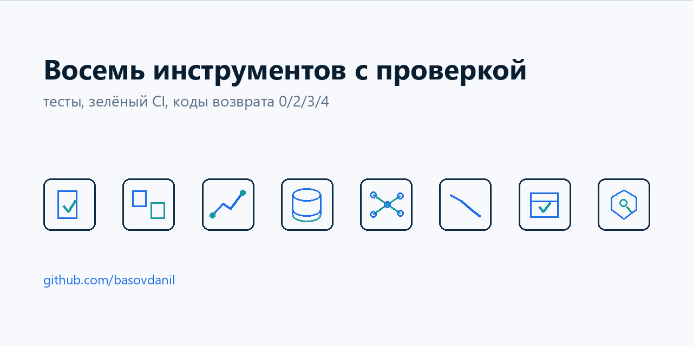

  

# Данил Басов

Делаю отчёты на данных, которые можно перепроверить. Выгрузка идёт в расчёт, а в конце скрипт проверки возвращает `0`, если всё сошлось, или `4`, если есть расхождение.

## Инструменты

Восемь репозиториев, у каждого тег `v1.0.0`, тесты и зелёный CI. Шесть — на стандартной библиотеке Python, ставить нечего: скачал файл и запустил.

| Инструмент | Что экономит вам | Чем проверено |
|:--|:--|:--|
| [osv-check](https://github.com/basovdanil/osv-check) | Находит 5 дефектов в оборотно-сальдовой ведомости до того, как цифры ушли в отчёт | 13 тестов · CI · `v1.0.0` |
| [table-etl](https://github.com/basovdanil/table-etl) | Слияние, дифф и раскладка выгрузок одной командой: 51 → 45 строк без ручной сверки | 11 тестов · CI · `v1.0.0` |
| [forecast-baseline](https://github.com/basovdanil/forecast-baseline) | Пять бейзлайнов за один запуск: сезонность даёт MAPE 8,81 % против 14,92 % у наивной | 16 тестов · CI · `v1.0.0` |
| [sql-analytics](https://github.com/basovdanil/sql-analytics) | Десять SQL-отчётов и 12 сверок: отчёт не уйдёт, если разбивка не сходится с итогом | 19 тестов · CI · `v1.0.0` |
| [titanic-baseline](https://github.com/basovdanil/titanic-baseline) | Дисциплина кросс-валидации: три модели, фиксированные seed'ы, проверка артефактов | 28 тестов · CI · `v1.0.0` |
| [churn-baseline](https://github.com/basovdanil/churn-baseline) | Порог подобран по out-of-fold, а не 0,5: AUC 0,8446 при дисбалансе 26,5 % | 19 тестов · CI · `v1.0.0` |
| [hh-vacancy-check](https://github.com/basovdanil/hh-vacancy-check) | Не тратит отклик на закрытую вакансию: дедлайн берётся из блока schema.org | 16 тестов · CI · `v1.0.0` |
| [pii-scan](https://github.com/basovdanil/pii-scan) | Находит почты и телефоны в CSV до отправки файла наружу, в отчёте только маски | 15 тестов · CI · `v1.0.0` |

Живое демо: [hh-vacancy-check](https://basovdanil.github.io/hh-vacancy-check/) — вставьте id вакансии
или исходник страницы и получите `OPEN`/`CLOSED`.

Два инструмента подключаются в свой CI одной строкой: `uses: basovdanil/hh-vacancy-check@v1`
и `uses: basovdanil/pii-scan@v1` — оба возвращают отчёт в `outputs.result` и могут ронять сборку.

## Кейсы

| Кейс | Данные | Результат |
|:--|:--|:--|
| [ОСВ: найти дефекты](https://basovdanil.github.io/portfolio/case-osv/case-osv.html) | 16 счетов, вымышленные | 5 дефектов: красное сальдо, разрыв итогов, отрицательный оборот |
| [Вакансии: выгрузка без персональных данных](https://basovdanil.github.io/portfolio/case-jobs/case-jobs.html) | trudvsem.ru, открытые | 505 строк, 0 почт, 0 телефонов |
| [Операции: одна команда](https://basovdanil.github.io/portfolio/case-tables/case-tables.html) | три файла, синтетика | слияние, сравнение версий, раскладка: 9 из 9 сверок |

Числа в таблице посчитаны скриптами по CSV из репозитория.

## Стек

Python, SQL и Excel. К каждому результату приложен скрипт проверки: арифметика, дубликаты, сходимость разбивки с итогом.

## Ссылки

- Страницы кейсов: https://basovdanil.github.io/portfolio/
- Код и данные: https://github.com/basovdanil/portfolio (7 скриптов, 13 CSV, 2 книги)
- Почта: basovdanil@yandex.ru

---

## English

  

Data analyst in retail and food manufacturing. My rule: a report is only done when a separate check
script recomputes it and returns `0` on match or `4` on a mismatch — every case and project below
ships with that check, its data and its tests.

**What these tools save you**, one line each:

- [osv-check](https://github.com/basovdanil/osv-check) — catches five defects in a 1C trial balance
  before the numbers go into a report.
- [table-etl](https://github.com/basovdanil/table-etl) — merge, diff and split spreadsheet exports
  in one command: 51 rows in, 45 out, duplicates gone.
- [forecast-baseline](https://github.com/basovdanil/forecast-baseline) — five baselines in one run;
  weekly seasonality scores MAPE 8,81 % against 14,92 % for naive.
- [sql-analytics](https://github.com/basovdanil/sql-analytics) — ten SQL reports and twelve
  reconciliations, so a report cannot ship when its parts disagree with the total.
- [titanic-baseline](https://github.com/basovdanil/titanic-baseline) — cross-validation discipline:
  three models, fixed seeds, verified artifacts.
- [churn-baseline](https://github.com/basovdanil/churn-baseline) — the threshold is tuned on
  out-of-fold predictions, not 0.5: AUC 0,8446 at 26,5 % positives.
- [hh-vacancy-check](https://github.com/basovdanil/hh-vacancy-check) — stops you spending an
  application on a vacancy that is already closed.
- [pii-scan](https://github.com/basovdanil/pii-scan) — finds e-mails and phones in a CSV before it
  leaves the company; the report carries masks only.

Live demo: [hh-vacancy-check](https://basovdanil.github.io/hh-vacancy-check/) — paste a vacancy id or
the page source and get `OPEN` / `CLOSED`.

Two of them work as GitHub Actions: `uses: basovdanil/hh-vacancy-check@v1` and
`uses: basovdanil/pii-scan@v1` — both return a report in `outputs.result` and can fail the build.

Cases with numbers: <https://basovdanil.github.io/portfolio/> · Every repository is tagged
`v1.0.0`, has a green CI badge and an English README.
